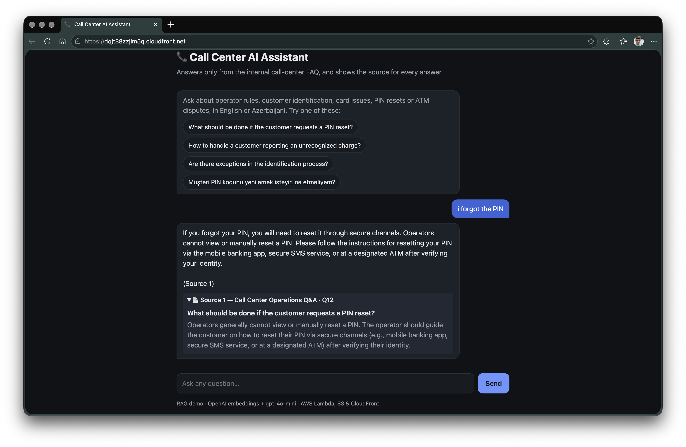
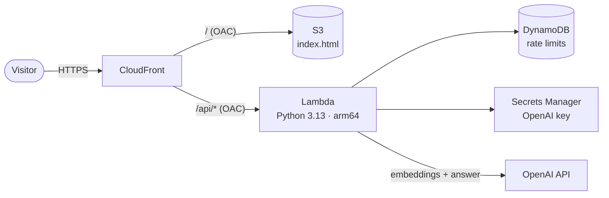

# 📞 Call Center AI Assistant

A retrieval-augmented generation (RAG) chatbot that answers call-center operator questions **only from an internal FAQ**, cites the FAQ entry behind every answer, and refuses questions the FAQ doesn't cover. It runs serverless on AWS for about $1 a month.

**Live demo: https://dqjt38zzjlm5q.cloudfront.net**



## Features

- **Grounded answers.** The model sees only the retrieved FAQ entries and must cite them as "(Source N)". Each answer shows clickable source cards with the original FAQ text.
- **Refuses off-topic questions.** Questions far from every FAQ entry are rejected before any LLM call. Questions that pass that check but aren't answered by the sources are rejected by the model.
- **Multilingual.** Ask in English or Azerbaijani; the answer comes back in the same language.
- **Abuse protection.** Questions are limited to 500 characters, and there are daily limits per visitor and overall, stored in DynamoDB.
- **No dependencies.** The application code uses only the Python standard library, so the Lambda package is just three files.

## Architecture



- **CloudFront** is the only public entry point. It serves the page from a private **S3** bucket and forwards `/api/*` to a **Lambda function URL**. Both origins accept only requests signed by this distribution (Origin Access Control); direct access returns 403.
- **Lambda** embeds the question, finds the closest FAQ entries, checks the rate limits, and asks the LLM for a grounded answer.
- **IAM** is least-privilege: the Lambda role can read one secret, update one table, and write its own logs.

### How a question is answered

1. **Indexing** (offline, `embedder.py`): parse the FAQ PDF into topic/question/answer items and embed each one with `text-embedding-3-small`. The result is saved to `faq_meta.json`.
2. **Retrieval** (`rag.py`): embed the question and rank the FAQ items by cosine distance, in memory, keeping the top 3.
3. **Relevance check**: if the best match is farther than a measured threshold, reply with a refusal and skip the LLM call.
4. **Generation**: `gpt-4o-mini` answers from the numbered sources only (temperature 0.2) and cites them.
5. **Citations**: the cited sources are parsed from the answer and returned to the UI as expandable cards.

## Tech stack

Python · OpenAI API (embeddings, Responses API) · AWS Lambda · Amazon S3 · Amazon CloudFront · Amazon DynamoDB · AWS Secrets Manager · IAM · Docker · HTML/CSS/JavaScript

## Run locally

Requires Python 3.11+ and an OpenAI API key.

```bash
echo "OPENAI_API_KEY=sk-..." > .env
python local_server.py            # http://127.0.0.1:8000
```

`local_server.py` serves the page and routes `/api/ask` to the same Lambda handler that runs on AWS. Rate limits are disabled locally.

Or with Docker:

```bash
docker build -t call-center-assistant .
docker run --rm -p 8000:8000 --env-file .env call-center-assistant   # http://localhost:8000
```

### Rebuild the index after editing the FAQ

```bash
pip install -r requirements.txt   # PyMuPDF, for PDF parsing
python embedder.py
```

The parser expects this layout in the PDF: a topic title, then numbered questions (`1. Question?`) followed by their answers, with `*****` after each answer and `**********` at the end of each topic.

## Deploy

The AWS resources were created with the AWS CLI in `eu-central-1`. To publish code or page changes:

```bash
./deploy.sh
```

## Project structure

```
rag.py              retrieval, relevance check, prompt, answer generation
lambda_function.py  HTTP handler: validation, rate limits, JSON response
local_server.py     local dev server using the same handler
embedder.py         FAQ PDF parser and embedding indexer
web/index.html      single-page chat UI (no build step)
faq_meta.json       FAQ items + embeddings (generated)
FAQ_RAG.pdf         source FAQ
deploy.sh           publishes code and page to AWS
Dockerfile          container for running locally
```
